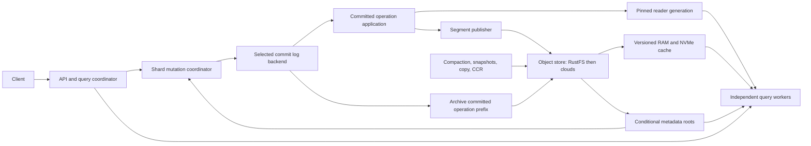

# System architecture and correctness contract

Status: proposed implementation architecture, with [cost research decisions executed now](research/cost-decisions.md). Decisions D01-D16 are tracked in [risks.md](risks.md). Implementation tasks and their evidence live in [roadmap.md](roadmap.md). [Operating profiles](operating-profiles.md) make cost, latency and failure-domain choices explicit.

## Service roles and durable state

One Rust workspace builds a node binary with configured roles. Co-locate roles for local development; deploy them independently for isolation and scaling. API coordinators authenticate requests, resolve index aliases and schemas, and fan out. Index workers own ordered shard application and segment production. Query workers serve immutable reader generations. Maintenance workers compact, archive, collect unreachable objects, and run copy/replication jobs. The optional journal role persists consensus logs on dedicated durable volumes.



Object storage holds immutable Lucene files or packs, manifests, encrypted key envelopes, archived operations, catalog pages, durable pins, schema history, and job state. It is the complete durable tier in object mode. In quorum mode the unarchived tail additionally requires the journal voter volumes. RAM, query cache, materialized files, and indexing scratch are disposable. Loss of scratch may delay recovery but must not lose acknowledged mutations.

## Identities and authority

Use opaque UUIDs for deployment, tenant, index, shard incarnation, and crypto domain. Names are aliases and can be reused without reusing history. A logical partition is `(tenant_uuid,index_uuid,shard_id,incarnation)`. A mutation identity also includes authority activation, writer epoch, and monotonically ordered shard sequence. Keep the shard sequence distinct from a physical quorum group's log index.

The authoritative conditional structural head binds activation, mode, membership/writer epochs, epoch inventory, checkpoint/tail locator, schema and publication generation. It does not advance on every data batch. The researched default is an ordered **fenced append lane**, using conditional creation of its next slot as the WAL commit point. Small streams can share a domain within one tenant and compatible crypto/residency/durability policy; hot streams use dedicated domains. M03.08 implements and qualifies this selected direction, rather than postponing the initial research. Shared publication does not promise arbitrary cross-shard API transactions.

A structural head is never deleted/recreated while its domain incarnation exists, preventing ABA resurrection. Ownership/membership and checkpoint/base publication use conditional authority transitions; ordinary data append does not add a second per-batch head CAS. Every lane instance first establishes its own fence and confirms current authority. A successor seals every relevant predecessor lane before serving new writes. A logical shard descriptor may reference the domain; it cannot independently grant write authority. Time-based leases improve liveness only; clock expiry alone never fences an in-flight storage operation.

Exactly one append may be in flight per lane. The next data slot and successor fence race on linearizable conditional create. Successful data before the seal is recoverable, including a late successful reply; a fence collision prevents the append. Any conflict, failure or ambiguous reply poisons that lane instance: it may resolve the exact operation identity, but cannot skip to another slot. Fences are not reclaimed by ordinary WAL truncation; retain a tail locator and a boundary/sequence-aware recovery proof. Same-term reopen, delayed stale PUTs after GC and older unfenced activations have explicit M03/M06 tests. An arbitrary UUID object is still an orphan; it is not equivalent to an authorized ordered slot.

Promoting a hot shard to a dedicated domain first seals that shard's source membership at a committed prefix, then publishes the target activation only after proving it can recover the prefix. Delayed source proposals remain fenced. Crash/response-loss at every cross-head step may cause temporary unavailability, never simultaneous independent authorities. M03's model and M03.08 qualify the selected protocol's page/key/recovery overhead and this transfer proof before format ratification. A global tenant manifest that serializes every hot stream is not an acceptable substitute.

In quorum mode the activated group's consensus configuration owns ordering and membership. The object head binds that authority and cannot appoint a competing writer just because a node lease expires. Migration quiesces old writes, seals a committed prefix, publishes a durable recovery root, and conditionally changes activation. The target proves it has that prefix before admitting writes. Old tokens and writers fail epoch checks.

Membership/placement gossip is a hint. It neither grants tenant access nor permits a write, nor certifies replica freshness. Use capacity-aware rendezvous placement within zone-local serving cells, with cross-zone alternatives governed by the selected profile. Check authorization/checkpoint eligibility before ranking latency or cost. Peers validate identities and requested checkpoints again after routing. Quorum voters preserve their required failure-domain diversity regardless of serving affinity.

## Non-negotiable invariants

1. Every successful durable mutation has exactly one authoritative committed outcome, including a recorded failure/no-op if the sequence contract requires it.
2. Retrying an uncertain request with the same idempotency key and payload returns the original outcome within its documented retention window. Different payload reuse is rejected. After expiry, report an expired key rather than claim indefinite deduplication.
3. Search, realtime GET, conditional preparation, and refresh never use an operation that is not committed under the selected authority.
4. An immutable reader identifies the contiguous applied prefix it covers. Query and fetch use the same pinned generation.
5. A published manifest references only complete, checksummed, readable immutable objects and the exact schema/engine/crypto dependencies needed to open them.
6. A compactor or obsolete writer can never resurrect objects below a durable GC boundary. Pins are registered before a snapshot is handed out; pin creation and GC must use a coordinated generation protocol.
7. Tenant identity derives from validated credentials and policy, never a caller-supplied path or unchecked peer field.
8. All queues, fanout, replay, decompression, cache population, and diagnostic responses have independent byte/count/time budgets before allocation.
9. Only authenticated AEAD plaintext is handed to decoders. Header/length bounds apply before decryption and decompression; malformed objects cannot trigger unbounded allocation.
10. Unknown mandatory protocol/format/cipher capabilities fail explicitly. Neither mixed-version nodes nor disabled modules silently weaken a contract.

## Mutation sequence

1. Authenticate, authorize tenant/index/operation and apply quotas. Validate request size, schema generation, routing, idempotency key, and preconditions.
2. Forward to an eligible shard mutation coordinator. Serialize conflicting document operations and prepare against **committed** version state. Scripts/patches are resolved once to concrete index/delete operations; replay does not rerun time, randomness, or external calls. Sandboxed scripting requires its own limits and is not implicit arbitrary code execution.
3. Assign canonical sequence/version identity. Encode the resolved payload, schema reference, request digest, idempotency outcome, and preconditions/result in a bounded versioned WAL frame. Failed commits cannot authorize dependent preparations using their speculative state.
4. Commit through the activated backend. In object mode, validate resolved operation/schema/crypto dependencies, encode the batch with its initial wrapped DEK, and conditionally create the **next ordered slot of the established lane**. That successful create is the commit point; no extra mutable-head CAS or key-sidecar PUT is mandatory per batch. A timeout may mean committed: poison the lane and resolve that exact slot/request identity before any new activation/replay decision. Do not skip a slot or assign a replacement identity blindly. In quorum mode, the consensus backend returns a majority-persisted committed coordinate under the selected failure-domain profile.
5. Apply committed operations to the serving writer in sequence. Keep preparation metadata private. Refresh only the committed state, using either the same writer after commit or an explicitly separate serving writer if preparation needs speculative engine operations. Benchmark the duplicate-indexing fallback and implement a narrower engine hook if it fails cost targets.
6. Return durability and application outcomes. A durable record whose engine application fails remains recoverable; block that shard and report a committed-but-unavailable outcome rather than pretending the durable operation was rolled back. A searchable-write request waits for an immutable reader satisfying its token or reports a timeout with the committed identity intact.
7. Archive/flush/refresh on bounded size/age thresholds, batching only dirty compatible streams. Idle shards/domains do not emit periodic empty objects or per-shard polling/heartbeats. Meter payload, commit, metadata-page/key writes and actual retry attempts separately. Publication and retention use committed prefixes, not the largest sequence merely observed. Cost pressure cannot change accepted deadlines, quorum, freshness or data retention guarantees.

Local Lucene `segments_N` commits and distributed operation commit are different events. A local commit can contain only committed operations; it never independently acknowledges a distributed mutation. On recovery, replay from the last verified base checkpoint with operation identities and no duplicate scripts. State needed for create/CAS/version behavior and idempotency survives recovery independently of a transient writer map.

## Checkpoints and read modes

| Coordinate | Meaning |
| --- | --- |
| committed | Authoritative contiguous mutation prefix under one activation |
| applied | Prefix installed in a serving engine |
| searchable | Prefix covered by a particular immutable reader |
| archived | Prefix present in verified object WAL chunks and published recovery metadata |
| base | Prefix represented by immutable Lucene segment snapshot |
| follower durable/applied/searchable | Separate destination replication coordinates, never source acknowledgement |

Applied cannot exceed committed; searchable cannot exceed applied; archived/base cannot imply later history exists. A sequence can be a logical no-op, but gaps must be represented so checkpoint arithmetic stays contiguous. A multi-shard token is a bounded vector or a durable reference to one, not an unbounded HTTP header.

Object-mode receipts also identify lane/domain activation, ordinal and batch position so the committed data is locatable before a newer segment/checkpoint manifest exists. Checkpoints amortize discovery/replay, not data acknowledgement. Latest reads obtain an actual authority/tail barrier; a cached structural head or segment manifest cannot certify the newest WAL suffix. Meter barrier RPCs, exact-version validation and bounded tail reads. Recovery may use a bounded charged listing fallback; normal writes/queries do not list the log to discover every append.

Public modes: `published` reads a pinned published snapshot and returns its generation; `at_least(token)` waits or routes to a replica covering the requested shard prefixes; `latest` obtains an authoritative committed barrier for each target shard and requires those barriers in the response. Failure to meet a deadline is a freshness error. Partial search is explicit opt-in and names every missing/stale shard. There is no silent fallback from `at_least`/`latest` to stale cache.

Initially, a multi-shard search pins one generation per shard and promises per-shard consistency, not one globally serializable instant. PIT stores that vector durably and pins all dependencies. Cross-index alias resolution uses a fixed catalog generation. Exact cross-shard term statistics require an explicit DFS phase; default shard-local BM25 compatibility must be documented. Top-k ordering includes deterministic tie breaks, bounded score/field merge, and stable pagination. Aggregation approximation and limits are explicit.

## Engine integration

Use native Rust engine APIs behind `EngineFactory`/`ShardEngine`, not the Java FFI facade as the long-term embedding boundary. M02 verifies open/index/update/delete/commit/refresh/reader/merge and original identity preservation at the pinned revision. Enumerate unsupported query and analyzer features rather than infer parity from crate names.

First establish a correct materialized-file backend with disk reservations and checksums. Then deliver a bounded remote-input contract with explicit errors and reads. A cold file cannot require an in-memory `Vec` equal to its full size. Async storage preparation can populate encrypted cache blocks; CPU decode executes in a bounded blocking/search pool. No network wait runs on Tokio's core executors. Avoid unsafe sparse mmap tricks; an mmap points only to complete immutable files held by reference-counted cache leases.

Trace engine file opens, random access, metadata reads, and codec locality on actual queries. Adapt all affected readers, not only the directory interface. Preserve local byte compatibility with Java where the engine promises it; an outer packed/encrypted object format is versioned separately. Upstream patches belong in a narrow patch series with conformance tests; every engine revision runs the bridge contract and old-index corpus before adoption.

## Object layout and publication

Proposed layout, subject to M03 format ratification:

```text
v1/<deployment>/tenants/<tenant_uuid>/
  catalog/<page_id>/<generation>
  indexes/<index_uuid>/descriptor/<generation>
  domains/<domain_uuid>/<incarnation>/HEAD
  domains/<domain_uuid>/<incarnation>/maps/<page_uuid>
  domains/<domain_uuid>/<incarnation>/wal/<activation>/<lane>/<ordinal>
  shards/<shard_id>/<incarnation>/descriptor/<generation>
  shards/<shard_id>/<incarnation>/manifests/<manifest_uuid>
  objects/<crypto_domain>/<object_uuid>
  keys/<object_uuid>/<envelope_uuid>
  pins/<pin_uuid>
  jobs/<job_uuid>/<generation>
```

UUID identities avoid content-derived names leaking cross-tenant equality. WAL slot names deliberately encode ordering inside an opaque domain/activation/lane; each slot contains immutable data or a fence. The payload has its own immutable crypto object identity and initial wrapped DEK; `keys/` holds later overlays or separately published non-WAL envelopes. Do not delete occupied fences or reuse lane names. Manifests include hashes, lengths, logical file extents, block map, engine/format version, schema, crypto-envelope references, and checkpoint. Large manifests use immutable bounded pages with a small root. LIST is permitted for paginated catalog/GC repair, inventory and a bounded charged cold-activation/recovery fallback. Normal appends and queries do not list to find the tail: snapshot paths derive from authenticated manifests, and fresh tail paths from committed receipts or authoritative barriers.

Writer: pin engine commit, upload immutable objects/envelopes, verify dependencies, upload manifest, conditionally publish root, release local pin. Compactor: pin inputs, build replacement, validate source generation and delete/update coverage, conditionally replace only the matching sources. Losing proposals leave reclaimable objects. GC marks current roots, PIT/snapshot/CCR/copy pins and in-flight publication roots, advances a durable boundary, then sweeps eligible objects after revalidation. Destructive tests must suspend and resume old publishers across GC; a long grace period is not the sole safety mechanism.

## Recovery, placement, and scale

Recover catalog root, activation and schema, fetch a base manifest, verify dependencies, replay committed archive and any quorum tail, rebuild state and a reader, then advertise readiness with a searchable coordinate. Spill bounded replay/external sorting to reserved scratch where necessary. Duplicate identity with different payload is corruption; missing committed history blocks readiness. Do not infer deletion from a temporarily unavailable object.

Millions of idle indexes consume catalog storage, not an active writer, timer, stream, or Raft group each. Activate shards on demand; cap active engines/readers per node. Split hot logical shards through a fenced copy/catch-up/cutover protocol with routing-generation tokens. Existing PITs pin old topology. M13 delivers this protocol rather than leaving fixed shard count as the scaling ceiling.

In quorum mode, multiplex logical streams into bounded physical groups and enforce per-tenant admission so one archive backlog cannot consume every group's space. The group snapshot and truncation protocol must retain all represented streams' durable/recovery metadata. Reconfiguration follows the library's proven membership protocol. A query replica is eligible only after checkpoint validation; placement affinity does not confer freshness.

For outages: preserve warm published reads only under their explicit staleness contract; fail `latest` if authority cannot be reached. Stop object-mode writes when publication is unavailable. Quorum mode can continue within its bounded archive-lag/disk budget, then reject new writes before space exhaustion. Certificate expiry, revoked keys, disk faults, or missing history remove readiness with a structured reason. [Operations and AI interfaces](ai-harness.md#ai-operations-interface) cover diagnosis.
