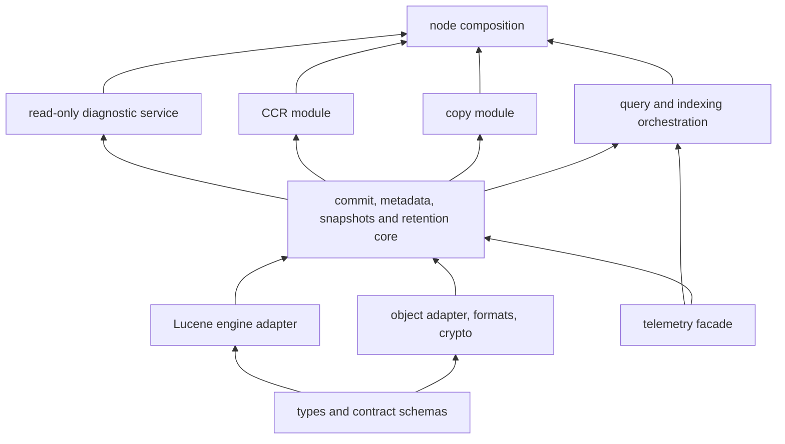

# Module boundaries and extension contracts

Status: proposed. Extensibility is a product requirement. A provider is usable only when its capabilities and conformance evidence meet the deployment's policy. Initial trusted modules are compiled as Rust crates; optional modules can be absent without leaving no-op endpoints that report success.

## Dependency direction and ownership



Arrows mean lower layer is a dependency of the higher layer. The foundational telemetry facade depends on types only. Adapters implement traits owned by the layer that consumes them. Composition wires providers; core never imports the node binary. Copy and CCR depend on core snapshot/change-stream capabilities, not on each other's controllers. No extension depends on an internal path in `lucene-*`; only the engine adapter does.

Proposed initial crate families: `hsearch-types`, `hsearch-observe`, `hsearch-object`, `hsearch-format`, `hsearch-crypto`, `hsearch-engine`, `hsearch-core`, `hsearch-query`, `hsearch-node`, `hsearch-testkit`. Add `hsearch-log-quorum`, `hsearch-copy`, `hsearch-ccr`, and specific cloud/KMS adapters when their milestones need them. Avoid generating dozens of empty crates at bootstrap. Dependency and capability checks must cover normal, build, dev, optional-feature and target-specific edges. Testkit is not linked into release binaries.

## Concrete extension catalog

| Contract | Initial implementation and later providers | Invariants enforced by core; required conformance |
| --- | --- | --- |
| `ObjectBackend` | RustFS through S3 adapter; S3/GCS/Azure later | Immutable create, exact-version bounded range, conditional update outcome, metadata round trip, checksum, multipart abort, timeout/cancel. Never emulate CAS with GET+unconditional PUT |
| `MetadataStore` | Conditional commit-domain roots and paged catalog | Epoch/activation/membership transitions, hot-shard promotion, publication/pin/GC coordination, conflict/unknown outcome and full request accounting. Optional SQL adapter must satisfy identical history tests |
| `CommitLog` | Fenced conditional-create object WAL first; persistent quorum module | Ordered resolved operations, one in-flight append per object lane, poison on unknown/failure, retained fences, slot receipts, replay/tail barriers and amortized checkpoints. Capability advertises commit protocol, failure model and archive dependency |
| `EngineFactory` / `ShardEngine` | Pinned Lucene Rust adapter | Mutation identity, idempotent replay, private preparation, reader cuts, merge/commit pins, supported formats and feature inventory |
| `RemoteInput` | Engine read-at/range bridge plus materialized fallback | Bounds, error propagation, immutable version identity, cancellation at I/O boundary, codec conformance; no hidden runtime reentry |
| `BlockCache` | Foyer RAM/NVMe candidate | Key includes tenant/crypto domain, immutable object/version, extent and format. Best-effort failure cannot corrupt a successful source read. Cache error policy is explicit |
| `CompressionCodec` | Independently compressed LZ4/Zstd blocks after measurement | Decode ratio/length bounds, deterministic format IDs, old reader capability; compress before encrypt |
| `KeyProvider` | Test KMS then AWS KMS, GCP KMS, Azure Key Vault; Vault/HSM via adapter | Wrap/unwrap and optional native rewrap/generate; exact key version/context, typed denial/throttle/unavailable, deadlines, no plaintext logs |
| `DataCipher` | Vetted AES-256-GCM AEAD library | Fixed suite IDs, authenticated headers/chunks, nonce policy, backend dispatch test. Provider cannot invent a format or weaken tag validation |
| `IdentityProvider` | File-backed development CA; SPIFFE workload provider | Peer identity/role/trust domain, certificate rotation, bundle updates and expiry, separate public/peer audiences |
| `Authenticator` / `Authorizer` | OIDC/JWT or API credentials and scoped tenant policy | Verified identity types, tenant/index/action scopes, audit, revocation and cache bounds. Node certificate alone does not grant universal tenant permission |
| `PeerTransport` | H2 + rustls mTLS; measured QUIC extension | Bounded typed frames, admission before allocation, deadlines, no cert-error downgrade, no 0-RTT mutation replay |
| `QueryExtension` | Parser/IR lowering, ranking/collector capabilities | Typed logical plan, resource estimates, cancellation, deterministic pagination, safe shard result reduction; unknown DSL rejected |
| `AnalysisExtension` | Audited Lucene analyzers, versioned dictionaries | Schema binds analyzer version/data hashes so recovery, copy and CCR reproduce terms |
| `IngestTransform` / `SourceConnector` | Validated transforms; bulk/OTel, Kafka/CDC later | Deterministic resolved output, checkpoint semantics, rate/size/time limits, scoped external credentials and replay behavior |
| `SnapshotExport` / `ChangeStream` | Core committed snapshot plus resolved-op stream | Stable manifest/sequence cut, schema dependencies, source identities, checksums, durable pins and retention leases |
| `CopyController` | Optional one-time cross-cluster materialization | Destination-private staging, independent keys/storage, resumable status and atomic destination activation |
| `ReplicationController` | Optional follower-pull active-passive CCR | Durable applied checkpoint, retention policy, schema-before-ops, duplicate/gap detection, explicit promote/fence workflow |
| `RetentionParticipant` | PIT, backup, copy and CCR modules | Modules may add bounded pins or withhold deletion; none can approve deletion of another participant's live dependency |
| `TelemetrySink` / `DiagnosticProvider` | OTel/Prometheus + structured read-only diagnostics | Redaction at producer, bounded cardinality/body/time, authenticated tenant scope, schema version, no shell/code execution |
| `SchedulerPolicy` | Capacity/zone/affinity policy | Policy recommends placement only. Core checks authority, topology, freshness, admission and safe draining |
| `CostPolicy` / `CostMeter` | Versioned rate card, profile and traffic/request accounting | Meter actual provider attempts and directed physical edges, including retries. Policy can defer optional work or reject new admission; core prohibits quorum/freshness/security/retention downgrades |

## Contract shape

Use opaque validated identifiers and versioned data types from `hsearch-types`. An illustrative design, **not a final Rust API**:

```text
ModuleDescriptor = {id, version, contract_versions, capabilities, dependencies,
                    resource_limits, format_read_set, format_write_set}
RequestContext = {verified_identity, tenant_scope, deadline, cancellation,
                  byte_budget, trace_context}
CommitReceipt = {activation, shard, sequence, request_digest,
                 durability_profile, commit_protocol, lane_epoch?, ordinal?, batch_position?,
                 committed, applied?, searchable?, archived?}
ProviderError = Conflict | UnknownOutcome | Unavailable | PermissionDenied |
                Throttled(retry_after) | Unsupported | Corrupt | Cancelled
```

`UnknownOutcome` is not a retry hint without identity resolution. Cancellation after acceptance cannot discard a committed operation. Providers return budgets consumed and stable error codes rather than dumping internal requests or secrets. The core records provenance and chooses permissible retry/backoff policies.

Trusted in-process adapters use async interfaces for I/O and explicit blocking CPU execution. Rust traits with async methods need an intentional object-safety strategy: enum dispatch for fixed provider sets, boxed futures or a vetted macro for runtime registry boundaries. Avoid boxing/virtual calls inside decode/scoring loops; dispatch once per block or query plan. Benchmark compile time/code size as well as runtime overhead.

## Registration, lifecycle and compatibility

At startup, validate duplicate IDs, dependency cycles, mandatory capabilities, configuration schema, format/suite support, and permissions before readiness. Lifecycle is `validate -> probe -> start -> ready -> drain -> stop`. Draining rejects new work, settles accepted commits, checkpoints resumable jobs, releases resources, and stops background tasks within a deadline. Unsupported essential capabilities fail closed; optional module absence is discoverable through a capabilities endpoint.

Persist the IDs and versions needed to read on-disk data. Removing a module that owns referenced formats/keys is refused until data is migrated. Rolling upgrades use an intersection of readers' supported formats and a cluster write-format epoch; do not emit a new format merely because one new node can write it. Downgrade is possible only if no unreadable format has been published. Key policy, authority and cipher changes require explicit migration protocols, not hot replacement of live trait objects.

Separately deployed modules use versioned protobuf/HTTP contracts with mTLS and scoped capabilities. Untrusted query/ingest code may later use WASM with memory/fuel/network restrictions, but it is a separate qualified runtime. Native dynamic loading is not promised. The first release exposes extension traits and composition features with reproducible builds.

## Proof that the seams work

M03-M12 include two implementations or a fault-injecting provider where needed: object backend versus memory fake, materialized versus remote input, object versus quorum log, test KMS versus a real cloud provider, disabled versus enabled copy/CCR. Run the same contract suites against each provider; passing a fake never substitutes for integration. Add an example external module using only public contracts. Dependency CI must prove that removing copy/CCR from the build removes its controller/endpoints while ordinary search and snapshots remain functional.

Required negative tests include unknown module/version, unsupported cipher, missing key provider on old data, duplicate registry IDs, unsupported conditional writes, late cancellation, provider panic, stalled drain, cross-tenant cache lookup, disabled-module calls, and resource-budget exhaustion. Review module API changes as architecture changes with migration notes and matched tests.
